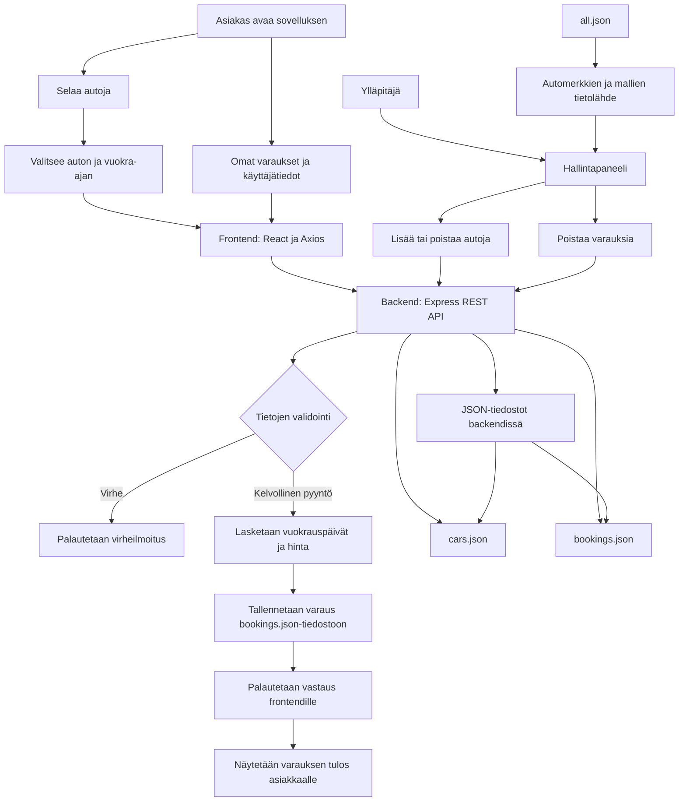

# Autojen varausohjelma

Päätin tehdä Airbnb-tyylisen autonvuokraus-sivuston.

Alunperin ajatuksena oli vain että teen yksinkertaisen varastohallinnan, jolla autoja lisätään/poistetaan, asetetaan huoltotilaus/annetaan aika. Mutta se muuttui sitten tässä useiden eri kokeiluerien jälkeen tähän muotoon.
Aircrc (aircustomer-rent-car). Näin youtubessa Bootstrap-kirjastolla tehtyä reactia, jolloin sain idean lähteä niiden perusteella tekemään jotain.
https://getbootstrap.com/docs/6.0/getting-started/install/
Lopputuloksena Web-pohjainen autojen varausjärjestelmä, jossa käyttäjät voivat tarkastella vuokrattavia autoja ja tehdä varauksia. Ylläpitäjä hallitsee autovalikoimaa ja varauksia hallintanäkymän kautta.

## Ominaisuudet

- **Autojen selaus:** Tarkastele vuokrattavia autoja ja niiden teknisiä tietoja.
- **Varausten tekeminen:** Valitse auto sekä vuokrauksen alkamis- ja päättymispäivä.
- **Varausten tarkistus:** Järjestelmä tarkistaa varausten päällekkäisyydet ja laskee vuokrauksen kokonaishinnan.
- **Hallintapaneeli:** Ylläpitäjä voi lisätä ja poistaa autoja sekä poistaa varauksia.
- **Ajoneuvotietokanta:** `all.json` sisältää automerkit, mallit, sukupolvet ja saatavilla olevat tekniset vaihtoehdot.
- **Tietojen tallennus:** Autojen ja varausten tiedot tallennetaan JSON-tiedostoihin.

## Mitä projekti sisältää?

```text
AirCrc/
├── backend/
│   ├── data/
│   │   ├── all.json          # Ajoneuvomerkkien ja -mallien lähdedatasetti
│   │   ├── cars.json         # Vuokrattavien autojen tiedot
│   │   ├── bookings.json     # Varaustiedot
│   │   ├── users.json        # Käyttäjätiedot
│   │   └── rentedCars.js     # Vuokrattuihin autoihin liittyvä toiminnallisuus
│   ├── server.js             # Express-backend ja REST API
│   └── package.json
│
├── frontend/
│   ├── src/
│   │   ├── components/
│   │   │   ├── Footer.jsx
│   │   │   └── Navbar.jsx
│   │   ├── pages/
│   │   │   ├── Admin.jsx
│   │   │   ├── Booking.jsx
│   │   │   ├── CarDetails.jsx
│   │   │   ├── Cars.jsx
│   │   │   ├── Home.jsx
│   │   │   ├── MyBookings.jsx
│   │   │   └── MyPage.jsx
│   │   ├── services/
│   │   │   ├── booking.js
│   │   │   ├── cars.js
│   │   │   └── users.js
│   │   ├── styles/
│   │   ├── App.jsx
│   │   └── main.jsx
│   └── package.json
│
└── README.md
```

## Tietomalli ja skeema

### Autojen JSON-rakenne

Autojen tiedot tallennetaan `cars.json`-tiedostoon. Tiedot sisältävät auton perustiedot, vuokraushinnan, ominaisuudet ja kuvan. Ulkoisesta ajoneuvodatasetistä tuoduissa autoissa voi olla lisäksi tarkempia teknisiä tietoja, kuten moottorin teho, vääntömomentti, vetotapa ja mitat.

Esimerkki auton tietueesta:

```json
{
  "id": 1,
  "brand": "Toyota",
  "model": "Corolla",
  "year": 2023,
  "price": 45,
  "seats": 5,
  "transmission": "Automaatti",
  "fuel": "Hybridi",
  "availability": "Saatavilla",
  "engine": "1.8 l hybridi",
  "horsepower": 140,
  "displacement": "1798 cm³",
  "consumption": "4.5 l/100 km"
}
```

Datasetistä tuotujen autojen tekniset tiedot voivat sisältää myös seuraavat kentät:

```json
{
  "generation": "Huracan (2022)",
  "bodyType": null,
  "engineLabel": "5.2L V10 7AT RWD (610 HP)",
  "fuelType": "Gasoline",
  "powerHp": 610,
  "displacementCc": 5204,
  "cylinders": 10,
  "torqueNm": 565,
  "drivetrain": "Rear Wheel Drive",
  "zeroToHundredKmhS": 3.4,
  "topSpeedKmh": 261,
  "lengthMm": 4524,
  "widthMm": 1956,
  "heightMm": 1247,
  "wheelbaseMm": 2629,
  "curbWeightKg": 1470
}
```

Kaikki tekniset kentät eivät ole käytettävissä jokaiselle autolle. Puuttuva tieto esitetään tarvittaessa `null`-arvona.

### Varausten JSON-rakenne

Varaukset tallennetaan `bookings.json`-tiedostoon `bookings`-taulukon sisään. Varaus yhdistetään autoon `carId`-kentällä ja asiakkaaseen `userId`-kentällä.

```json
{
  "bookings": [
    {
      "id": "1792065904992",
      "carId": 5,
      "userId": 2,
      "userName": "Asiakas Pertti",
      "startDate": "2026-10-15",
      "endDate": "2026-10-31",
      "totalDays": 16,
      "totalPrice": 12000,
      "status": "confirmed"
    }
  ]
}
```

Varaus sisältää seuraavat tiedot:

| Kenttä | Kuvaus |
|---|---|
| `id` | Varauksen yksilöivä tunniste |
| `carId` | Varattavan auton tunniste |
| `userId` | Varaavan asiakkaan tunniste |
| `userName` | Asiakkaan nimi |
| `startDate` | Vuokrauksen alkamispäivä |
| `endDate` | Vuokrauksen päättymispäivä |
| `totalDays` | Vuokrauksen kesto päivinä |
| `totalPrice` | Varauksen kokonaishinta |
| `status` | Varauksen tila, esimerkiksi `confirmed` |

### Tietojen käsittely

Frontend lähettää HTTP-pyynnöt Axiosilla Express-backendille. Backend käsittelee pyynnöt ja lukee tai päivittää JSON-tiedostoihin tallennettuja tietoja.

```text
React-frontend
      │
      │ Axios / HTTP
      ▼
Express REST API
      │
      ├── cars.json
      ├── bookings.json
      └── users.json

all.json
      │
      ▼
Automerkkien ja -mallien valinta
ylläpitonäkymässä
```

JSON-tiedostot toimivat projektin tietojen tallennusmuotona. Projekti ei näiden esimerkkien perusteella käytä erillistä relaatiotietokantaa.
## Teknologiat

| Teknologia | Käyttötarkoitus |
|---|---|
| React | Käyttöliittymä |
| Vite | Kehitysympäristö ja sovelluksen build |
| Axios | HTTP-pyynnöt frontendistä backendiin |
| Node.js | Backendin suoritusympäristö |
| Express | REST API |
| CORS | Frontendin ja backendin välisten pyyntöjen salliminen |
| JSON | Ajoneuvotiedot sekä autojen ja varausten tallennus |

## Toimintaperiaate



## Käynnistäminen paikallisesti

1. Kloonaa repositorio.
2. Asenna riippuvuudet.
3. Käynnistä backend ja frontend projektin määritetyillä npm-skripteillä.

```bash
git clone https://github.com/JKeskinen/aircrc/tree/main
```

## Tietojen tallennus

- `data/all.json` – ajoneuvojen valmistajat, mallit ja tekniset vaihtoehdot.
- `data/cars.json` – lisätyt vuokra-autot.
- `data/bookings.json` – tehdyt varaukset.
- `data/users.json` – käyttäjätiedot.

