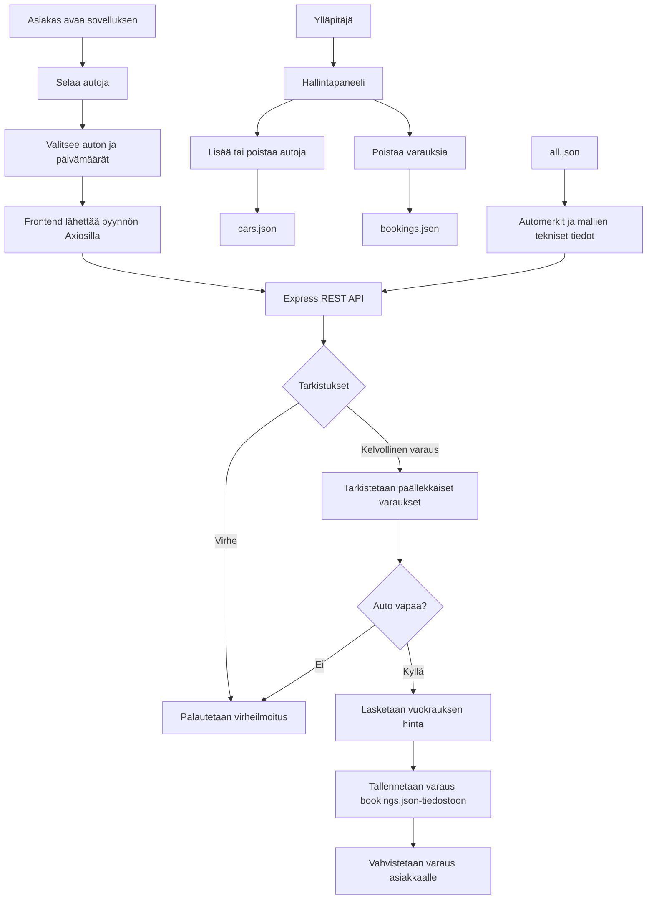

# Autojen varausohjelma

Web-pohjainen autojen varausjärjestelmä, jossa käyttäjät voivat tarkastella vuokrattavia autoja ja tehdä varauksia. Ylläpitäjä hallitsee autovalikoimaa ja varauksia hallintanäkymän kautta.

## Ominaisuudet

- **Autojen selaus:** Tarkastele vuokrattavia autoja ja niiden teknisiä tietoja.
- **Varausten tekeminen:** Valitse auto sekä vuokrauksen alkamis- ja päättymispäivä.
- **Varausten tarkistus:** Järjestelmä tarkistaa varausten päällekkäisyydet ja laskee vuokrauksen kokonaishinnan.
- **Hallintapaneeli:** Ylläpitäjä voi lisätä ja poistaa autoja sekä poistaa varauksia.
- **Ajoneuvotietokanta:** `all.json` sisältää automerkit, mallit, sukupolvet ja saatavilla olevat tekniset vaihtoehdot.
- **Tietojen tallennus:** Autojen ja varausten tiedot tallennetaan JSON-tiedostoihin.

## Teknologiat

| Teknologia | Käyttötarkoitus |
|---|---|
| React | Käyttöliittymä |
| Vite | Kehitysympäristö ja sovelluksen build |
| Axios | HTTP-pyynnöt frontendistä backendiin |
| Node.js | Backendin suoritusympäristö |
| Express | REST API |
| CORS | Frontendin ja backendin välisten pyyntöjen salliminen |
| JSON | Ajoneuvotiedot sekä autojen ja varausten tallennus |

## Toimintaperiaate



## Käynnistäminen paikallisesti

1. Kloonaa repositorio.
2. Asenna riippuvuudet.
3. Käynnistä backend ja frontend projektin määritetyillä npm-skripteillä.

```bash
git clone https://github.com/JKeskinen/aircrc/tree/main
```

## Tietojen tallennus

- `data/all.json` – ajoneuvojen valmistajat, mallit ja tekniset vaihtoehdot.
- `data/cars.json` – lisätyt vuokra-autot.
- `data/bookings.json` – tehdyt varaukset.
- `data/users.json` – käyttäjätiedot.

